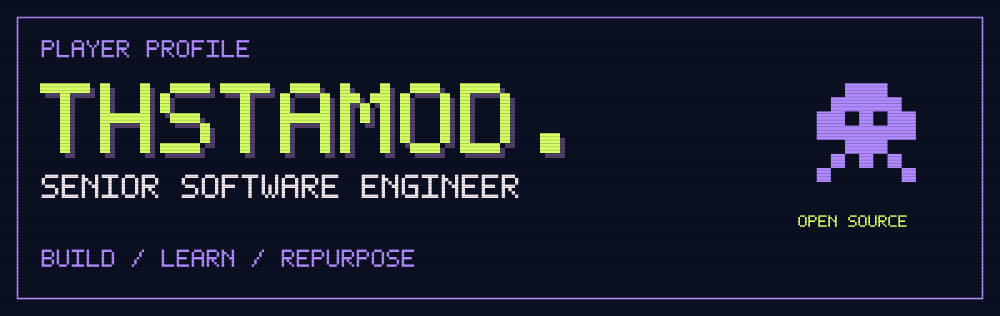

  

🧠 Building AI-powered tools and exploring how language models work.

🛠️ I enjoy experimenting, sharing projects as open source, and finding new uses for technology that others have given up on.

### 🧠 Chiron Core

An open-source earnings research application combining structured LLM extraction, source-evidence validation, human review, and reproducible evaluation workflows.

`TypeScript` `OpenAI API` `Node.js` `GraphQL` `Vue` `PostgreSQL` `Supabase`

### 🔬 Tiny Transformer

A small educational transformer built with PyTorch. Exploring tokenization, embeddings, attention, and training through an implementation I can inspect and understand.

`Python` `PyTorch` `Transformer fundamentals`

### ♻️ Old hardware, new possibilities

I like taking things that seem destined for the bin and figuring out what else they could become.

📍 For example, giving an old GPS device a new purpose—a little tinkering, a little problem-solving, and another reason to keep interesting hardware.

🤖 LLM integration and structured outputs  
🔎 Evidence validation and evaluation  
🧬 Understanding and training small language models  
⚙️ Reproducible data pipelines  
🔧 Repurposing old hardware  
🌱 Building useful open-source software

  
  
  

